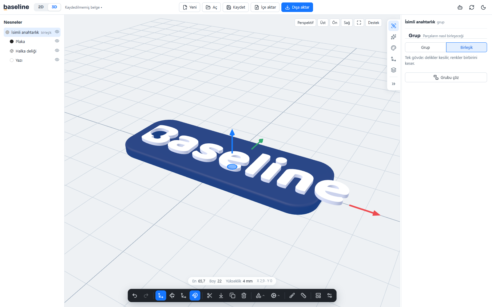
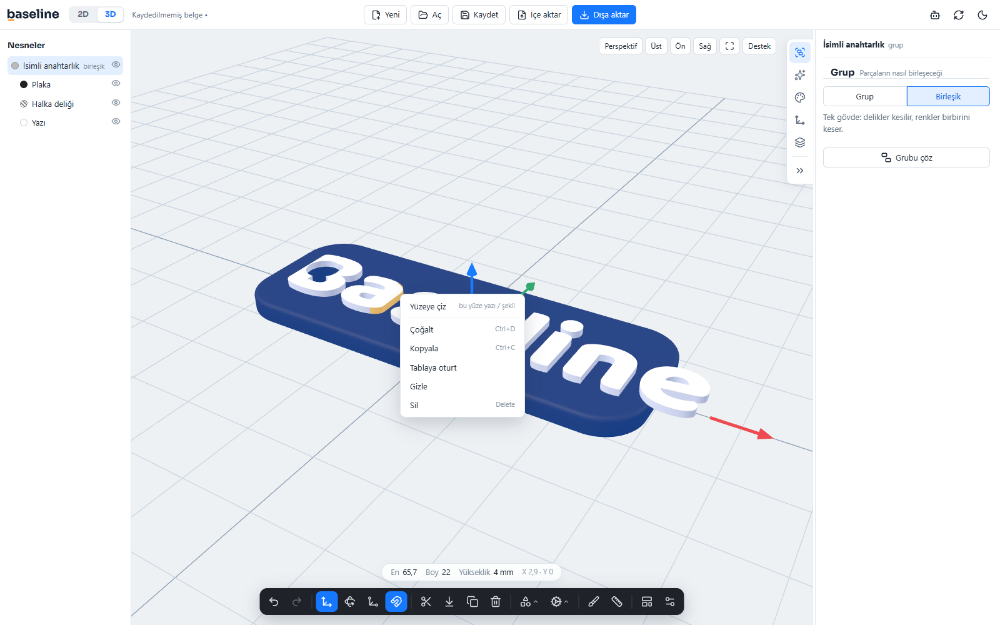
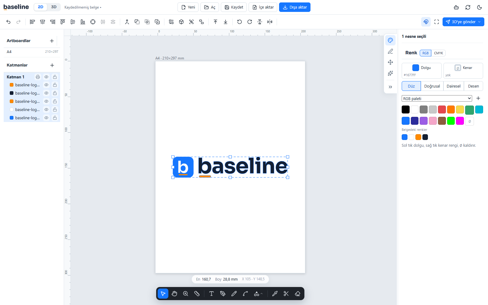
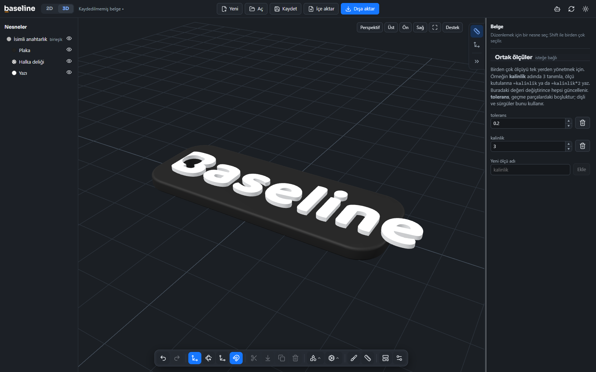

<p align="center">
  <picture>
    <source media="(prefers-color-scheme: dark)" srcset="brand/logo/baseline-yazi-beyaz.svg">
    
  </picture>
</p>

<p align="center"><b>3D yazıcı için tasarım programı: 2D vektör çizim ve 3D modelleme tek yerde.</b><br>
Tinkercad kadar kolay, parametrik, Türkçe; CorelDRAW alışkanlıklarıyla çalışan bir vektör sayfası ve baskıya hazır çıktı.</p>

<p align="center">
  <a href="https://github.com/hbaydemir/baseline/releases/latest"></a>
  <a href="https://github.com/hbaydemir/baseline/releases/latest"></a>
</p>



## Baseline nedir?

Baseline, 3D yazıcıyla üretim yapanlar için tek bir masaüstü program olmayı hedefler. Bir anahtarlığı, bir kutuyu, bir mekanik parçayı modellerken aynı anda logosunu, etiketini, kataloğunu ve UV baskı ya da lazer için yüzey çizimini de aynı belgede hazırlarsın.

- **Kolay:** Şekil ekle, sürükle, ölçüsünü yaz. Her şey Türkçe, her ayarın ne yaptığı yanında yazar.
- **Parametrik:** Belge bir “tarif”tir, üçgen yığını değil. Bir ölçüyü değiştirirsin, model baştan kurulur; efektler bozmadan üst üste eklenir, istediğin zaman kapatılır.
- **2D ve 3D birlikte:** Üst köşedeki **2D | 3D** anahtarıyla vektör sayfası ile 3D model arasında geçersin. Vektör çizimi bir yüze kabartma olarak oturtur, bir yüzün şeklini vektör sayfasına alırsın.
- **Baskıya hazır:** Çok renkli 3MF (Bambu Studio dahil), STL, OBJ; vektör tarafında birebir mm ölçülü PDF, SVG, DXF, PNG ve JPG.
- **Yapay zekâya açık:** Claude ve Codex, MCP bağlantısıyla açık belgeyi senin yerine düzenleyebilir; sen ekranda canlı izler, Ctrl+Z ile geri alırsın.

## İndir ve kur

1. [Son sürüm sayfasından](https://github.com/hbaydemir/baseline/releases/latest) **`Baseline_x.y.z_x64-setup.exe`** dosyasını indir.
2. Çift tıkla ve kurulumu bitir. Yönetici izni gerekmez; program yalnızca senin kullanıcı hesabına kurulur.
3. Windows “bilinmeyen yayımcı” uyarısı gösterirse **Ek bilgi → Yine de çalıştır**'a bas. Kurulum dosyası henüz dijital imzalı değil.
4. Başlat menüsünden **Baseline**'ı aç. `.baseline` dosyaları da artık çift tıklayınca Baseline'da açılır.

**Güncellemeler:** Program açılışta yeni sürüm var mı diye bakar. Sol paneldeki kartın en altında kurulu sürüm yazar; yeni sürüm varsa yanında “Yeni: v…” ve **Güncelle** düğmesi çıkar, tıklayınca yenilikleri görür, indirme sayfasına gidersin. Aynı kartta yapay zekâ bağlantısı ve açık / koyu tema anahtarı da durur. Yeni sürümü kurmak eskisinin üstüne yazar, belgelerine dokunmaz.

**Gereksinimler:** Windows 10 ya da 11, 64 bit. macOS ve Linux sürümü henüz yok.

## 3D modelleme

- **60'tan fazla parametrik şekil.**
  - **Temel:** Kutu, silindir, küre, koni, piramit, halka, tüp, kama, poligon, yıldız, kalp, kapsül, kemer, ok, damla, hilal, konuşma balonu, rozet, spiral, yay, petek plaka, QR kod, yazı ve dahası.
  - **Mekanik parçalar:** Dişli ve eş dişli çifti, yerinde basılan menteşe, ray/sürgü, kapaklı kutu, vida ve somun (ve yuvaları), ısıtmalı insert yuvası, mıknatıs ve rulman yuvası, tırtıllı topuz, geçmeli klips, kablo klipsi, esnek menteşe, vidalı kavanoz, kremayer, GT2 kasnak, rotil, L köşebent, 2020 T-somun, tolerans testi.
- **Efektler (sırayla, açılıp kapanır):** Balon (şişkin yazı), üst/alt kenar pahı, burgu, daralt, bük, dalga, düzlemle kes, sadeleştir, dizi (çoğalt), aynala, içini boşalt.
- **Grupla ve birleştir:** Gruplar birlikte hareket eder; birleşik gövdede delikler kesilir, renkler birbirini keser.
- **Böl:** Kesim düzlemiyle parçalara ayır. Yarıları dübel ya da geçmeli pim kilidiyle tak; pimler otomatik yerleşir ya da elle konur, baskı yerleşimine kendiliğinden yatırılır.
- **Ölç:** İki nokta arası, köşeye ve kenar ortasına yapışarak; yüzden yüze uzaklık ve yüz açısı.
- **Boya:** Yüzün tamamını ya da fırçayla bir bölgeyi boya; çok renkli 3MF ve OBJ'ye aktarılır.
- **Ölçü şeridi:** Seçili nesnenin eni, boyu, yüksekliği ve konumu araç kutusunun hemen üstünde.

### Yüzeye çiz

Nesneyi seç, imleci bir yüzün üstüne getir: yüz parlar. Sağ tıkla **Yüzeye çiz**: o yüzün tam şekli ve ölçüsüyle 2D çizim ekranı açılır. Yazı, şekil ya da SVG ekle, **kabartma** ya da **oyma** olarak kaydet; düz ya da eğri yüzeye oturur. Yüzün şeklini ve tasarımını **vektör sayfasına gönder**ip UV baskı ve lazer için birebir ölçülü PDF / SVG alabilirsin. Kabartma / oyma ve yükseklik ayarı sağ panelin **Yüzey** sekmesindedir. Bitirdiğin çizimi sonradan aynı yüzde yeniden **Yüzeye çiz** ile (ya da kabartmayı seçip **Vektörde düzenle** ile) açarsın; yazılar yine düzenlenebilir yazı olarak gelir. Yüzeye çiz açıkken üstteki **İçe aktar** ve **Dışa aktar** yüzey çizimi için çalışır. Yazı hizası (sola, ortaya, sağa, iki yana) üst çubuktaki hizalama düğmelerinin yanındadır.



## 2D vektör çizim

Vektör sayfası, CorelDRAW kullananların alışkanlıklarıyla çalışır: aynı kısayollar, aynı mantık.



- **Artboardlar:** A3, A4, A5, A6, kartvizit, kare ya da özel ölçü; aynı sayfada yan yana.
- **Çizim araçları:** Seç, kaydır, yakınlaştır, ölçü çizgisi, yazı, kalem (Bezier), serbest el, şekil aracı (düğüm düzenleme), 38 hazır şekil, damlalık, bıçak, silgi.
- **Corel kısayolları:**
  - L R T B C E P ile hizalama, eşit dağıtma.
  - Ctrl+G/U ile grupla ve çöz, Ctrl+L/K ile birleştir ve parçala.
  - Ctrl+Q eğriye çevir, Ctrl+Shift+Q çizgiyi nesneye çevir.
  - Ctrl+R son işlemi tekrarla, Ctrl+Shift+D adımla çoğalt.
  - F4 tümünü göster, F5 serbest el, F6 dikdörtgen, F7 elips, F8 yazı, F10 şekil aracı.
- **Döndürme:** Seçili nesneye bir kez daha tıkla: köşelerden döndür, kenar ortalarından eğ, döndürme merkezini taşı.
- **Mıknatıs:** Düğüm noktalarına, yolun üstüne, nesne kenarlarına, ortalara, artboarda ve kılavuzlara pembe hizalama çizgileriyle yapışır.
- **Şekillendirme:** Kaynaştır, kırp, kesişim, sadeleştir, kontür, geçiş (blend), PowerClip, zarf/bükme, köşelere pah ve yuvarlatma.
- **Yazı:**
  - Ekranda doğrudan yazarsın.
  - Harf harf renk, yazı tipi ve boy verirsin.
  - Paragraf kutusu satır kaydırır, iki yana yaslar.
  - Yazıyı bir yola oturtabilirsin.
  - Bilgisayardaki bütün yazı tipleri, kalınlık ve italikleriyle kullanılabilir.
- **Renk:** Dolgu ve kenar için her zaman açık renk seçici ve 16 renkli palet (sol tık dolgu, sağ tık kenar), RGB ve CMYK modu, kendi paletlerin, şeffaflık ve gölge.
- **Dolgu tipi:** Düz, Gradient, Desen. Gradient türleri: doğrusal, dairesel, konik, kare. Hazır desenler: noktalar, eğik ve yatay çizgi, kareli, dama, çapraz tarama, zikzak, dalga, tuğla, üçgen (renk dolgudan gelir); ya da kendi çiziminden desen oluştur. Çubuğa çift tıkla durak ekle, ara durağa çift tıkla kaldır, durağa tıklayınca rengi hemen altta.
- **Damlalık:** Bir nesnenin dolgusunu, gradientini, kenarını ve efektlerini alıp başkasına uygular; imleç önce damlalık, sonra boya kovası olur.
- **Kenar çizgisi:** Kıl çizgiden kalına; kesik çizgi tipleri; çizgi uçlarına ok, nokta, kare.
- **Resim:** JPG, PNG, TIFF, WEBP, BMP sürükle-bırakla gelir. Sağ tık **Vektöre çevir** canlı önizlemeyle logoyu renk renk vektöre çevirir. Resmi soluklaştırıp kilitleyerek üstünden çizebilirsin.
- **Katmanlar:** Gizle, kilitle, “yazdırılmasın”; nesneleri sürükleyerek katmanlar arasında taşı.
- **3D'ye gönder:** Çizimi tablaya ayrı bir kabartma olarak ya da 3D modelde bir yüze oturtarak gönder.

## Dosyalar

| | Açar / içe aktarır | Kaydeder / dışa aktarır |
| --- | --- | --- |
| **Belge** | `.baseline` (2D ve 3D birlikte) | `.baseline`; ilk kayıttan sonra her değişiklik otomatik kaydedilir. Kaydet düğmesi “Üzerine kaydet” ya da “Farklı kaydet” sorar; kaydedilmemiş değişiklik varsa düğmede turuncu nokta yanar |
| **3D** | STL, OBJ, 3MF (renkler ve Bambu boyası dahil), SVG; otomatik onarım | 3MF (çok renkli, Bambu profiliyle), STL, OBJ |
| **2D** | SVG, PDF, AI (PDF uyumlu), DXF, JPG, PNG, TIFF, WEBP, BMP | PDF (her artboard ayrı sayfa ya da tek sayfa), AI, SVG, DXF, PNG, JPG |

Belgede hem 3D model hem vektör çizim varsa Baseline açarken hangisini açacağını sorar.

## Şablon yöneticisi

Şablonlar programın içinde gelmez; ayrı dosyalar olarak eklenir ve Masaüstündeki **Baseline Templates** klasöründe durur.

- **İçe aktar:** Satın aldığın ya da indirdiğin `.baseline` şablonlarını "İçe aktar" ile ekle. Dosyada kategori yoksa "Genel"e konur.
- **Kategoriler ve arama:** Soldaki ağaçtan kategori ve alt kategori seç, ada, açıklamaya ya da etikete göre ara. "Resmî" ve "Benim" filtreleri var.
- **Özelleştir:** Şablona tıkla; ölçü, yazı, logo (SVG), renk, şekil seçenekleri ve aç-kapa parçaları değiştirip sahneye ekle.
- **Resmî şablonlar:** Baseline tarafından imzalıdır, mavi rozetle görünür. Adı, kategorisi ve açıklaması değiştirilemez; dosya değiştirilirse rozetini kaybeder.
- **Kendi şablonların:** Açık belgeyi ya da seçili nesneleri "Yeni şablon" ile kaydet. Ad zorunlu; kategori ve açıklama isteğe bağlı. Sonradan "Bilgileri düzenle" ile değiştirebilirsin.
- **Tasarım havuzu:** Sık kullandığın STL, OBJ, 3MF, SVG ve .baseline dosyalarını havuzda tut.

## Baskı asistanı

Modelini baskıdan önce kontrol eder: desteğe ihtiyaç duyan yerler, tablaya oturma, tahmini ağırlık ve süre. Bir sorun çözücü, ayar el kitabı ve destek rehberi de içerir.

## Yapay zekâ ile çalışma

Baseline, Claude ve Codex için bir MCP sunucusuyla gelir. Programda **Yapay zekâ bağlantısı** penceresindeki komutu bir kez çalıştır. Sonra “Baseline'da 60 mm'lik, yazısı kabartma bir anahtarlık yap” demen yeterli. Açık ve kaydedilmiş belge değişir, ekranda canlı görürsün, Ctrl+Z ile geri alırsın. Bunun için bilgisayarda Node.js kurulu olmalı.



## Kısayollar

| 3D | | 2D | |
| --- | --- | --- | --- |
| W / E / R | Taşı / döndür / ölçekle | Boşluk | Seç ↔ şekil aracı |
| F | Sığdır | L R T B C E P | Hizala |
| M | Ölç | Ctrl+L / Ctrl+K | Birleştir / parçala |
| Ctrl+D | Çoğalt | Ctrl+Q | Eğriye çevir |
| Ctrl+C / X / V | Kopyala / kes / yapıştır | Ctrl+R | Son işlemi tekrarla |
| Ctrl+Z / Y | Geri al / yinele | F4, Shift+F2 | Tümünü / seçiliyi göster |
| Ctrl+S / Ctrl+Shift+S / Ctrl+O | Kaydet / farklı kaydet / aç | F5 F6 F7 F8 F10 | Serbest el, dikdörtgen, elips, yazı, şekil aracı |
| Tab | Sağ paneli gizle / göster | Tab | Sağ paneli gizle / göster |

## Yol haritası

Sıradaki ve tartışılan işler [TODO.md](TODO.md) dosyasında. Şu an konuşulanlar: 3D'de kenara tıklayıp pah veya yuvarlatma vermek ve bir köşeyi serbestçe şekillendirmek.

## Kurumsal kimlik

Logo, renkler ve yazı tipi kuralları [brand/Baseline-Kurumsal-Kimlik.pdf](brand/Baseline-Kurumsal-Kimlik.pdf) dosyasında; SVG logolar [brand/logo](brand/logo) klasöründe. Logoda ve markada kullanılan Sora yazı tipi SIL Open Font License ile dağıtılır.

---

<details>
<summary><b>Geliştiriciler için: kaynak koddan çalıştırma</b></summary>

Gerekenler: Node.js 22+, Rust (Tauri 2 için) ve Windows'ta WebView2.

```
npm install
npm run tauri dev        # geliştirme
npm test                 # testler
npm run tauri build      # kurulum dosyası
npx tsx tools/brand.ts   # kurumsal kimlik kılavuzu, logolar, uygulama içi logo ve kurulum ikonu (.svg)
```

- `src/core`: geometri çekirdeği (manifold-3d). Arayüzden bağımsızdır; belge bir tariftir (JSON).
- `src/app`: React + Three.js arayüzü; 2D vektör düzenleyici `VectorEditor.tsx`, geometrisi `vectorOps.ts`, dışa / içe aktarma `vectorIO.ts`.
- `src-tauri`: masaüstü kabuğu.
- `tools`: MCP sunucusu ve komut satırı. Arayüzle aynı komutları kullanır (`src/core/doc.ts`).

Sürüm çıkarmak: `package.json` sürümünü artır, `v*` etiketi gönder; GitHub Actions kurulum dosyasını derleyip sürüm sayfasına koyar.

Komut satırı:

```
npm run cli -- schema
npm run cli -- apply model.baseline examples/demo.json
npm run cli -- run model.baseline betik.mjs
npm run cli -- import model.baseline parca.3mf
```

`run`, verilen JavaScript'i tam yetkiyle çalıştırır; yalnız güvendiğin betikleri kullan.

**3MF notları:** Bambu Studio 2.9 ile doğrulandı: A1, A1 mini, P1S (çok renk ve tam profil). Eksik ayarlı proje Bambu Studio'yu çökerttiği için profil ya tam gömülür ya hiç gömülmez (`src/core/bambu.ts`). X2D'de çok renkli dilimleme henüz çözülmedi.

</details>
